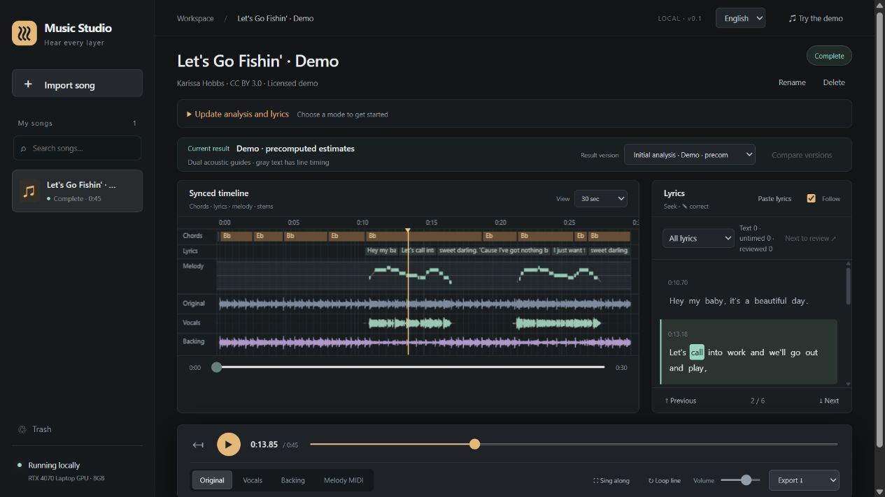
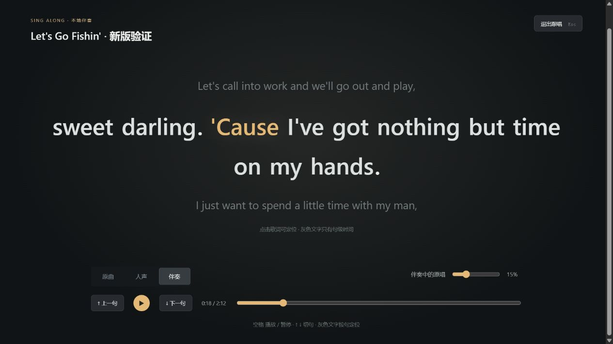

# Music Studio

> Music Studio focuses on song separation, lyrics, melody and beat analysis. Creation, arrangement and mixing belong to the independent [Music Workbench](https://github.com/Hydr0g3ngz/music-workbench).

[中文](README.md) · [Download installer](https://github.com/Hydr0g3ngz/music-studio/releases/latest) · [Quick start](QUICKSTART.md) · [Benchmark](docs/lyrics-v4.en.md) · [Roadmap](docs/roadmap.en.md)

**Unfold a song into vocals, backing, timed lyrics, vocal-melody MIDI, chords and beats — on one timeline.**

Runs locally in a desktop window, browser, CLI and Python engine. No account or paid API;
your songs stay on your computer. Switch **English / 中文** in the UI and keep your
preference. The Windows installer includes basic models for offline analysis.



*Actual UI. Example: Let's Go Fishin' — Karissa Hobbs, CC BY 3.0. Lyrics, timing and notes are machine estimates.*

## Install and analyze

1. Download **Music-Studio-0.1.4-Setup-x64.exe** from the [latest release](https://github.com/Hydr0g3ngz/music-studio/releases/latest).
2. Run the installer, then open **Music Studio** from the desktop or Start menu.
3. Import a song or choose **Try the demo**, switch stems, correct lyrics and export.

The installer includes **Python, NVIDIA CUDA inference dependencies, Demucs htdemucs,
Whisper small and CREPE full**. No Python setup, terminal, API key or additional
model download is needed for basic analysis. Missing Microsoft VC++ and WebView2 prerequisites are provided by the installer.

**Automatic** uses a verified NVIDIA GPU for separation, lyrics and melody.
CUDA and cuDNN are bundled; only a compatible NVIDIA graphics driver is required.
CPU remains a slower fallback. See [GPU validation and compatibility](docs/gpu-installer-validation.md).
Qwen and turbo are optional source configurations.
ACE-Step, composition and mixing belong to Music Workbench. Requires Windows
10 22H2 / Windows 11 x64; 16GB RAM and 10GB installation space recommended.
**Windows.zip is source code, not a portable offline app.** Close the app before
installing an upgrade; songs and lyric corrections are retained.
See [Quick start](QUICKSTART.md) for troubleshooting and preserving data.

### Source setup for developers

From source:

```powershell
git clone https://github.com/Hydr0g3ngz/music-studio.git
cd music-studio
.\scripts\setup.ps1 -Mode preview
.\scripts\launch.ps1
```

To analyze your own songs, explicitly install the inference runtime and base models:

```powershell
.\scripts\setup.ps1 -Mode full -Device cuda -DownloadModels
# Use -Device cpu without an NVIDIA GPU (slower inference).
.\scripts\launch.ps1
```

The launcher defaults to offline mode and finds a free local port without stopping
other services. Use its printed URL. NVIDIA 8GB VRAM is the main tested inference
target; macOS/AMD/Intel GPU inference has not been validated.

On Linux, create a Python 3.11/3.12 environment, install suitable CPU/CUDA PyTorch
wheels, then `pip install ".[ui,inference]"` and run `music-studio ui --open`.

For optional Qwen lyric recognition, after the base installation:

```powershell
.\scripts\setup_lyrics.ps1 -Models qwen
.\.venv\Scripts\music-studio.exe ui --model-dir .cache/models --asr-backend qwen --lyrics-alignment anchors --lyrics-python .artifacts/lyrics-env/Scripts/python.exe --offline --open
```

Qwen uses an optional separate environment and about 4.38GiB of weights. The base
installation does not silently add this download. For dual timing guides, download
the `large-v3-turbo` model with `music-studio models download --asr-model large-v3-turbo --model-dir .cache/models`
and add `--anchor-model dual`. More coverage can also worsen timing tails; listen to verify.

## Listen, correct and take the results with you

| Workflow | What you can do |
| --- | --- |
| Hear each layer | Demucs vocals/backing; position-preserving track switching and lazy caching; synthesized melody MIDI |
| Correct lyrics | Whisper or optional Qwen; seek by line, loop context, correct text, or paste correct lyrics for alignment |
| Review difficult phrases | Separate text hints from missing timing; generate a line candidate, compare and explicitly accept it; retain earlier versions and edits |
| Practice | Large sing-along lyrics, backing with adjustable guide vocals, line navigation and loops |
| Export | LRC/SRT, melody MIDI, vocal/backing audio, chord/beat CSV and project JSON |
| Manage songs | Search, rename, delete, undo and Trash restore; stop/resume analysis and rerun an existing song with a new model |



*The same CC BY 3.0 example. Song names and lyrics are never translated when changing UI language.*

## Evidence, including regressions

The frozen suite accounts for **43 cases**: 26 original component regressions and
17 Mandarin karaoke recordings. The new data was split into 8 development and 9
confirmation recordings before inference, grouped by singer and lyric overlap.

| Fixed comparison | Measured result |
| --- | --- |
| Mandarin confirmation: 9 recordings, 1113 reference characters | Whisper small CER **45.28%** → Qwen3-ASR 1.7B **14.65%** |
| Unchanged Qwen text, 7 English regressions | Correct words within 200ms onset / all timed references: **52.83% → 59.14%** |
| Dual guides on Mandarin confirmation | Coverage improved, but onset P90 worsened **0.616s → 0.713s**; dual guides remain optional |

These are small, domain-specific engineering checks, not an unseen-data leaderboard.
Model pretraining overlap is unknown. Gray text means missing reliable word timing,
not necessarily incorrect text. Vocal melody is a single-lead estimate; chords
currently cover major/minor/N. Review markers and model scores are not accuracy
probabilities. Long songs consume more browser memory.

[Report and interpretation](docs/lyrics-v4.en.md) · [Full per-case results](docs/lyrics-v4.md) · [Data and reproducibility](benchmarks/README.md)

## Help improve it

Issues and contributions in English or Chinese are welcome. Start with a reproducible
problem: installation that blocks first playback, lyrics that are hard to correct,
or exports that do not work downstream. Try the credited demo first; keep private audio out of public issues.

[Contributing](CONTRIBUTING.md) · [Roadmap](docs/roadmap.en.md) · [Changelog](CHANGELOG.md)

```sh
python -m pip install -e ".[ui,benchmark,dev]"
python -m ruff check .
python -m pytest -q
node --test tests/ui_playback.test.cjs tests/ui_i18n.test.cjs
python scripts/package_release.py
```

Core, API and playback checks require no neural weights. Real-model evaluation is
opt-in. No frontend build or external CDN. Original code is [MIT](LICENSE);
models, data and recordings retain their own licenses. See [third-party notices](THIRD_PARTY_NOTICES.md)
and [demo attribution](src/music_studio/ui/demo/ATTRIBUTION.md).
