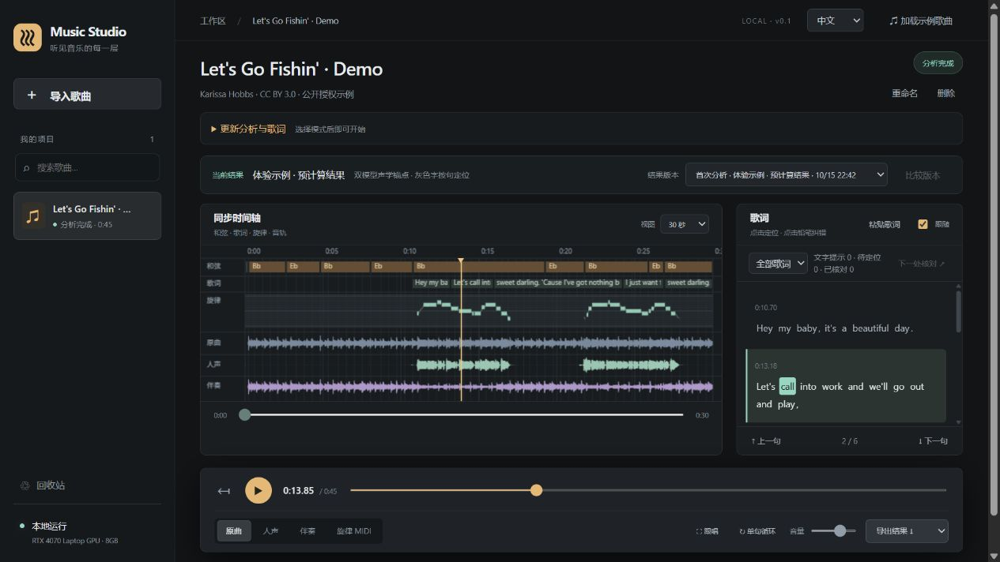

# Music Studio

> Music Studio 专注歌曲分离、歌词、旋律与节拍分析。创作、编排和混音平台是独立的 [Music Workbench](https://github.com/Hydr0g3ngz/music-workbench)。

[English](README.en.md) · [下载安装器](https://github.com/Hydr0g3ngz/music-studio/releases/latest) · [快速开始](QUICKSTART.md) · [实测](docs/lyrics-v4.md) · [路线图](docs/roadmap.md)

**把一首歌，展开成可以同步试听的人声、伴奏、歌词、主旋律 MIDI、和弦与节拍。**

在本机处理，通过独立桌面窗口或浏览器使用。无需账号或付费 API；歌曲不会上传到云端。
界面支持 **中文 / English**，可记住选择。Windows 安装包内置基础模型，可离线分析。



*真实界面。示例：Let's Go Fishin' — Karissa Hobbs，CC BY 3.0。歌词、时间与音符为机器估计。*

## 安装后即可分析歌曲

1. 从 [最新版本](https://github.com/Hydr0g3ngz/music-studio/releases/latest) 下载 **Music-Studio-0.1.4-Setup-x64.exe**。
2. 双击安装，完成后从桌面或开始菜单打开 **Music Studio**。
3. 导入自己的歌曲，或点击 **加载示例歌曲**，切换原曲、人声与伴奏，改字并导出。

这是在线安装器，会自动下载约 **2.20 GB** 的完整安装数据，支持取消后续传，并核对 SHA256。
安装完成后基础功能可离线使用。离线安装方法见 [快速开始](QUICKSTART.md)。

安装包包含 **Python、NVIDIA CUDA 推理环境、Demucs htdemucs、Whisper small 和 CREPE full**。
无需安装 Python、运行命令、配置 API 或另行下载基础模型。缺失的微软 VC++ 和 WebView2 组件由安装器安装。

默认“自动选择”优先使用通过运行检查的 **NVIDIA GPU**，无需另装 CUDA Toolkit 或 cuDNN。
安装兼容的 NVIDIA 驱动后，分离、歌词与旋律使用 GPU；CPU 可作为较慢的备用方案。
已验证的显卡与限制见 [GPU 安装版实测](docs/gpu-installer-validation.md)。
Qwen、Whisper turbo 为源码安装的可选配置；ACE-Step 和编曲混音不属于此产品。
支持 Windows 10 22H2 / Windows 11 x64，建议 16GB 内存、至少 10GB 安装空间。
**Windows.zip 是源码包，不是完整便携版**；升级时关闭软件并覆盖安装，歌曲与改字保留。
安装、故障处理和升级保留数据见 [快速开始](QUICKSTART.md)。

### 源码运行（开发者）

从源码体验：

```powershell
git clone https://github.com/Hydr0g3ngz/music-studio.git
cd music-studio
.\scripts\setup.ps1 -Mode preview
.\scripts\launch.ps1
```

分析自己的歌曲，明确安装推理依赖与基础模型：

```powershell
.\scripts\setup.ps1 -Mode full -Device cuda -DownloadModels
# 无 NVIDIA 显卡时改用 -Device cpu（推理较慢）
.\scripts\launch.ps1
```

启动器默认离线并自动选择空闲端口；不停止已有服务。浏览器地址以启动窗口为准。
NVIDIA 8GB 显存为主要本地验证目标；macOS、AMD / Intel GPU 推理尚未验证。
Linux 手动安装、Qwen 与双模型锚点、CLI 和输出格式见 [详细使用说明](docs/usage.zh-CN.md)。

## 一条时间轴，完成听、改、带走

| 场景 | 可以做什么 |
| --- | --- |
| 听清每一层 | Demucs 分离人声与伴奏；三轨切换保留位置，按需缓存；旋律 MIDI 可合成试听 |
| 改对歌词 | Whisper / 可选 Qwen 识别；点击逐句试听、循环上下文、文字纠错、粘贴正确歌词并对齐 |
| 核对难句 | 分开提示文字疑点与缺失时间；单句换模型生成候选，比较后明确采用；旧版本和改字保留 |
| 学唱与练习 | 大字跟唱视图，伴奏叠加可调原唱提示，逐句跳转与循环 |
| 带走结果 | LRC / SRT、主旋律 MIDI、人声 / 伴奏音频、和弦 / 节拍 CSV、完整项目 JSON |
| 管理歌曲 | 搜索、重命名、删除、撤销、回收站恢复；停止 / 继续分析，已有歌曲可用新模型重跑 |


*同一首 CC BY 3.0 授权示例。歌曲名与用户歌词保持原文，不随界面语言翻译。*

## 准确率用实测说明

冻结评测共 **43 例**：原 26 例组件回归，加 17 首中文卡拉 OK 录音。
新增数据先按歌手 / 歌词重合划分 8 首开发与 9 首确认，不自行补人工标签。

| 固定条件 | 结果 |
| --- | --- |
| 中文确认集 9 首 / 1113 参考字 | Whisper small CER **45.28%** → Qwen3-ASR 1.7B **14.65%** |
| 同一份 Qwen 文字，7 首英语回归 | 正确且起音误差 ≤200ms / 全部时间参考词：**52.83% → 59.14%** |
| 中文确认集的双模型锚点 | 时间覆盖提高，但起音 P90 **0.616s → 0.713s**，因此仍为可选项 |

这是小规模工程验证，含不同录音域，模型预训练重叠未知，不代表任意商业歌曲的准确率。
灰字只表示缺少可靠词时间，不等于错词。主旋律是单主唱估计，和弦目前为大小三和弦 / N；
自动结果仍需试听核对，核对标记与模型分数不是正确率。长歌曲占用更多浏览器内存。

[完整报告与逐例结果](docs/lyrics-v4.md) · [数据来源与复现命令](benchmarks/README.md) · [算法与时间基准](docs/architecture.md)

## 一起改进

欢迎用中文或英文提交可复现的安装、播放、识别问题。优先反馈：哪一步阻碍首次试听、
哪句歌词难以修正、哪种导出不好用。请先用内置授权示例复现，避免公开私人音频。

[贡献指南](CONTRIBUTING.zh-CN.md) · [English contributing guide](CONTRIBUTING.md) · [路线图](docs/roadmap.md) · [版本记录](CHANGELOG.md)

```sh
python -m pip install -e ".[ui,benchmark,dev]"
python -m ruff check .
python -m pytest -q
node --test tests/ui_playback.test.cjs tests/ui_i18n.test.cjs
python scripts/package_release.py
```

核心 / API / 播放测试不下载神经模型；真实模型评测需另行执行。前端没有构建步骤或外部 CDN。
代码采用 [MIT](LICENSE)。模型、数据与示例录音各自保留原许可，见 [第三方说明](THIRD_PARTY_NOTICES.md)
与 [示例署名](src/music_studio/ui/demo/ATTRIBUTION.md)。
