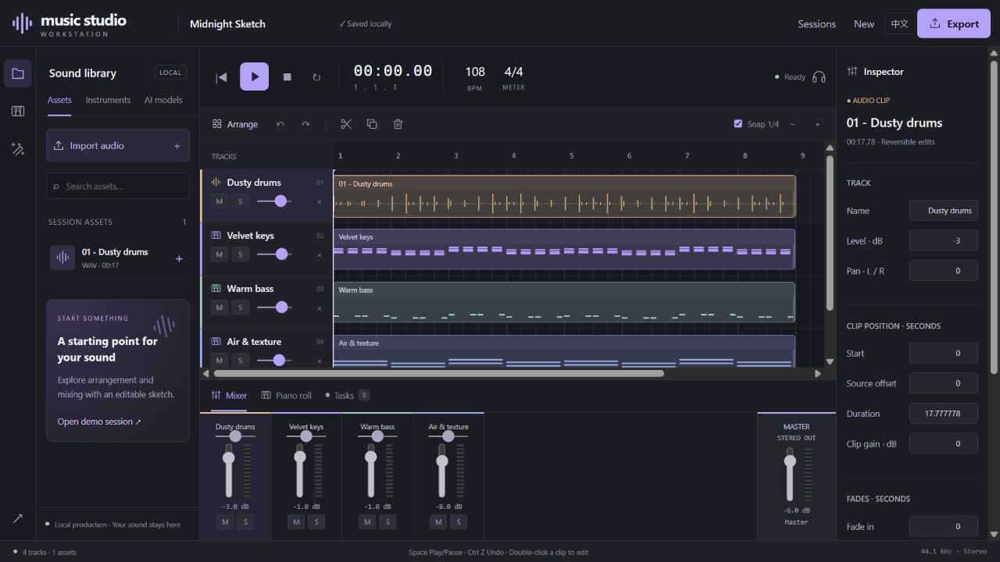

# Music production workstation: UI and first capabilities

[中文](create-preview.md) · [Roadmap](workbench-plan.en.md)



This is the `v0.2.0.dev5` production preview; the older published `v0.2.0.dev2` package
does not include this interface. Classic and the earlier Next interface remain available.
Use an independent workspace; older songs are not migrated automatically.
This batch adds [live mixing effects and presets](mixing.en.md).
[Sampled instruments, grooves and MIDI import](creation-library.en.md) are also available
for offline arrangement. Optional [local ACE-Step generation](music-generation.en.md)
creates drafts to audition and adopt into the same session.

Optional [Mel-Band RoFormer separation, audition and aligned replacement](separation.en.md), retaining originals with one-step undo.

## Start

Double-click `Start-Music-Studio-Create.cmd` in this development checkout. It uses
`outputs/create`, port 8903 by default, and opens `/station.html`. Basic arrangement,
built-in instruments and exports need no neural models. First launch reuses Next's
separate environment setup; models still require their own configuration.

```powershell
.\Start-Music-Studio-Create.cmd
# Or use an existing Python environment:
music-studio ui --interface create --workspace outputs/create --port 8903 --open
```

The local validation service uses `outputs/create-preview`, separate from the retained
8900/8902 services. Do not run two services against the same workspace.

## Interface and connected functionality

| Area          | Working operations                                                                                                                                                           |
| ------------- | ---------------------------------------------------------------------------------------------------------------------------------------------------------------------------- |
| Asset browser | Multiple-file import, search, click/drag assets into tracks, editable synthetic demo                                                                                         |
| Arrangement   | Audio/MIDI tracks, track removal, clip movement, right-edge trim, duplicate, playhead split, snapping and zoom                                                               |
| Transport     | Shared clock, pause/stop/seek, session looping and BPM; Space toggles playback                                                                                               |
| Mixer         | Track/master faders, stereo balance, mute/solo and actual signal meters; live adjustments                                                                                    |
| Effects       | Three-band EQ, compression, reverb, four presets, dry A/B and optional master sample-peak limiting; undoable settings |
| Piano roll    | Three sampled instruments and three synths; note add/remove/audition, pitch/position/duration/velocity editing, MIDI import |
| Inspector     | Names, placement, source offset, duration, gain, fades and instrument selection                                                                                              |
| Sessions      | Create/reopen, autosave, undo/redo, recoverable trash; revision conflicts preserve the other window's work                                                                   |
| Exports       | 24-bit/44.1kHz stereo WAV, MIDI and project JSON snapshots                                                                                                                   |
| Models/tasks  | Existing runtime checks, queue and cancellation; add audio outputs as tracks, download other artifacts, open detailed results/lyric correction in the earlier Next interface |

`Midnight Sketch` contains programmatically synthesized drums and three editable MIDI parts.
It is not an AI generation quality demo. Source material survives clip edits; track removal
is undoable. Tasks do not overwrite the arrangement automatically. Language changes, task
polling and UI redraws do not reload active audio.

## Current boundaries

- Preview limits: 32 tracks, ten-minute sessions, 256 MiB decoded/synthesized playback budget, 256 MiB per upload.
- Fixed 4/4, 44.1kHz stereo; audio imports retain original files and create canonical copies.
- BPM affects the grid and MIDI. Audio does not automatically time-stretch.
- MIDI import, note addition/removal and numeric pitch/position/duration/velocity editing are available. Drag editing, pitch bends and other controllers remain planned.
- Three sampled instruments and three synth sounds are available. Generic SFZ/SoundFont import, VST, reorderable chains, buses/sends, automation, recording and full mastering are not implemented.
- ACE-Step 1.5 Turbo runs in an isolated environment; 12s and 20s instrumentals completed locally. Longer drafts and lyric quality remain unverified. YuE2 and DiffSinger are not integrated.
- Tasks process a selected clip's **full source audio**. Selection-only inference remains planned; each provider needs dependency/weight checks.
- JSON snapshots reference local audio rather than bundling it; they are not portable project archives.
- Master limiting defaults off and can be enabled explicitly. With limiting off, WAV export rejects overloads. This is not a true-peak limiter; see [mixing boundaries](mixing.en.md).
- Seek/resume/loop rebuild effect state; initial reverb/compression can differ from uninterrupted playback.
- Session looping reschedules at the boundary; professional gapless loops and low-latency recording are not promised.

## Validation

New backend checks cover unequal-rate/duration imports, placement/offsets, levels/balance/
mute/solo, source preservation, real WAV/MIDI, reopen/history, revision conflicts, recoverable
deletion, damaged inputs and overloaded exports. Engine checks cover deduplicated loading,
live updates, asynchronous start cancellation, synthesis and splitting. Browser acceptance
uses actual controls and audio rather than decorative waveforms or button presence.

2026-10-16: 125 Python and 37 Node checks passed. Actual browser verification covered import,
multitrack playback/mixing, track removal/undo, note removal/undo, placement edits, saved
renaming, both languages, WAV export and adding a completed local DPDFNet output as a second
track. MIDI export was verified through HTTP and file parsing.

See [mixing validation](mixing.en.md) for DSP and actual Chromium/WAV parity, live A/B/language checks and layout acceptance.
