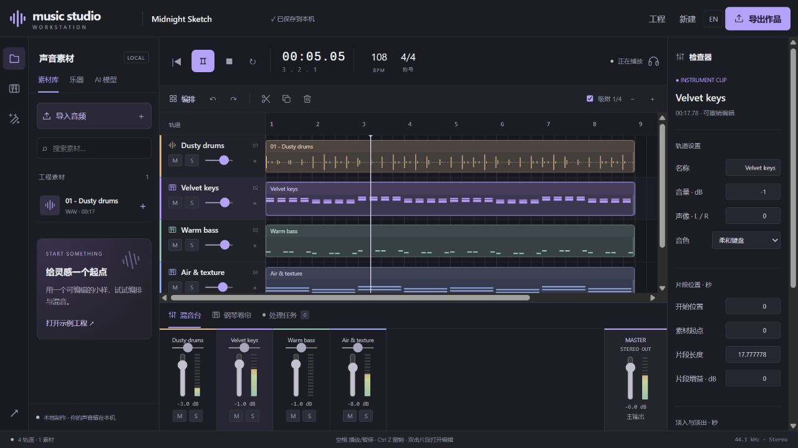

# 音乐制作工作台：界面与首批功能预览

[English](create-preview.en.md) · [开发路线](workbench-plan.md)



这是开发分支新增的制作界面，不包含在已发布的 `v0.2.0.dev2` 安装包中。
经典版和原 Next 入口继续保留。新工程使用独立工作区，不自动迁移旧歌曲。

## 启动

在本开发分支目录双击 `Start-Music-Studio-Create.cmd`。默认工作区为 `outputs/create`，
默认端口 8903，浏览器打开 `/station.html`。基础编排、内置音色与导出无需神经模型。
第一次启动沿用 Next 的独立环境安装流程；模型仍按需配置。

```powershell
.\Start-Music-Studio-Create.cmd
# 或者使用已有 Python 环境：
music-studio ui --interface create --workspace outputs/create --port 8903 --open
```

本次本机验收服务使用 `outputs/create-preview`，与既有的 8900/8902 Next 服务独立。
不要在两个服务中同时使用同一工作区。

## 界面与操作

| 区域          | 已接通的操作                                                                                |
| ------------- | ------------------------------------------------------------------------------------------- |
| 左侧素材库    | 多文件导入、搜索、点击/拖入素材；内置可编辑合成示例                                         |
| 中间编排      | 音频/MIDI 多轨，轨道增删，片段移动、右边缘裁剪、复制、播放头切分、吸附、缩放                |
| 顶部播放      | 统一播放时钟、暂停/停止/定位、工程循环、BPM；空格播放/暂停                                  |
| 下方混音台    | 轨道/主输出推子、左右平衡、静音/独奏、实际信号电平；播放中调整                              |
| 钢琴卷帘      | 三种基础合成音色；双击网格添加音符、双击音符移除，点击试听；双击 MIDI 片段打开              |
| 右侧检查器    | 轨道命名、位置、源偏移、长度、增益、淡入淡出、音色选择                                      |
| 工程菜单      | 新建、重开、自动保存、撤销重做、移入回收站与恢复；版本冲突不覆盖其他窗口                    |
| 导出          | 24-bit/44.1kHz 立体声 WAV、MIDI、工程 JSON 快照                                             |
| AI 模型与任务 | 复用现有模型检查/队列/取消；音频结果加入新轨，其他产物可下载，详细结果与歌词改字复用原 Next |

示例 `Midnight Sketch` 是程序生成的鼓点与三个可编辑 MIDI 声部，不是 AI 生成效果演示。
切分和裁剪保留原始素材，移除轨道可撤销。任务完成不自动覆盖工程。
切换语言、更新任务列表和界面重绘不重新载入正在播放的音频。

## 当前范围

- 预览上限为 32 条轨道、10 分钟工程、256 MiB 解码/合成音频的预览预算，单文件上传上限 256 MiB。
- 工程固定 4/4、44.1kHz 立体声；导入音频会生成保留原文件的标准化副本。
- BPM 调整作用于节拍网格与 MIDI；音频尚不自动时间拉伸。
- MIDI 编辑目前只提供基础音符增删和三种内置音色；尚未接入拖动调音高/时值、外部 MIDI 导入和完整调音参数。
- EQ、压缩/混响等效果链、总线/发送、自动化、录音、VST/采样器和完整母带处理尚未实现。
- ACE-Step、YuE2、DiffSinger 等创作模型清楚标为待接入，不能运行。
- 当前模型任务针对选中片段的**完整源音频**；片段选区推理后续接入。每个模型仍需独立检查依赖与权重。
- JSON 是本机工程编排快照，不携带音频文件，不能当成可跨机器恢复的完整工程包。
- 主输出超过 0 dBFS 时 WAV 导出拒绝削波并提示降低主推子；未加入自动限制器。
- 浏览器调度器会在工程循环边界重新安排播放，不承诺专业无缝 loop 或低延迟录音。

## 验证

新增后端测试覆盖：不同采样率/长度导入、片段位置和源偏移、音量/平衡/静音/独奏、
源文件保留、真实 WAV/MIDI、重开工程、撤销重做、并发版本冲突、删除恢复、损坏文件和过载导出。
前端引擎测试覆盖重复加载、播放中更新、异步启动取消、音符合成与片段切分。
浏览器验收使用实际控件和实际音频，不以按钮存在或装饰波形作为成功依据。

2026-10-16：103 项 Python 测试、26 项 Node 测试通过。浏览器已实际验证音频导入、
多轨播放/混音、轨道删除恢复、音符删除与撤销、位置修改、重命名恢复、中英切换、WAV 导出，
以及 DPDFNet 本地推理完成后把音频结果加入第二条轨道。MIDI 导出经 HTTP 与文件解析验证。
