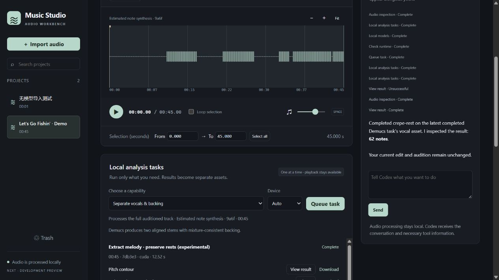

# Music Studio Next development preview

[中文](next-preview.md) · [Plan](workbench-plan.en.md) · [Melody comparison](melody-next.en.md)

This is **0.2.0.dev1** on `codex/audio-workbench-next`. It does not replace the stable release.
The original `main`, `v0.1.2` and song workspace are retained separately.

## Available now

- Import and edit without running separation, transcription or neural models first.
- Select ranges, enter times, zoom the waveform and loop playback.
- Trim, gain, fades, stereo balance, sample-peak normalization and reverse.
- Mix existing vocals/backing assets with identical sample timelines.
- Render separate previews; keep, undo and redo, with edit state surviving restarts.
- Export the audio being auditioned as 16/24-bit PCM or 32-bit float WAV.
- Rename, search, move projects to Trash, restore and switch English/Chinese.
- MCP and embedded Codex share projects, selections, previews and activity.
- Queue local stems, Whisper/Qwen transcripts, two melody decoders, beats and level checks.
- Check task state, cancel work, audition and download immutable output assets.
- Correct transcript lines as new versions with TXT/LRC/SRT. See [models and setup](next-models.en.md).

The classic analysis view and licensed 45-second precomputed demo remain available.
Importing your own audio does not automatically run the complete analysis pipeline.

## Start

On Windows, install Python 3.11/3.12 and double-click `Start-Music-Studio-Next.cmd`.
It installs a separate Next runtime on first start, without changing the stable `.venv`.
Manual setup is also available:

```powershell
.\scripts\setup-next.ps1
.\Start-Music-Studio-Next.cmd
```

Setup downloads UI, decoding and MCP dependencies from package repositories, without neural weights.
Next uses `.venv-next`, `outputs/next` and a separate port starting at 8900.
Development checkouts can also use an existing `.artifacts/workbench-env` runtime.
The stable app can keep running. Use `setup-next.ps1 -Python <interpreter>` to choose Python.

Linux/macOS or manual setup:

```bash
python3 -m venv .venv-next
source .venv-next/bin/activate
python -m pip install -e '.[ui,audio,agent]'
python -m music_studio ui --interface next --workspace outputs/next --port 8900 --open
```

## Codex and MCP

Open the **Codex assistant** tab and **Connect local Codex**. The installed Codex CLI needs an
existing login. The workbench does not read/copy credential files or change global configuration.

Try: “Lower the current audio by 3 dB and create a preview. Do not keep it yet.”
Actual tool results appear as `CODEX` preview cards. Listen, keep them, or continue manually.
Previews are the default; originals are retained. The UI and agent share revision conflict checks.

Audio processing stays local. Codex inference uses its service and receives the conversation,
transcripts it reads and tool results. Audio is not implicitly attached or uploaded. Measurements do not mean
the assistant has listened. Shell tools, external MCP servers, connectors and subagents are disabled
for this embedded process, without changing global settings.

Tested CLI: `0.162.0-alpha.17.2`. Dynamic tools in the official app-server remain experimental;
other versions may need adaptation.

To use existing Codex through MCP, launch:

```text
<Next Python> -m music_studio.studio.mcp --workspace <absolute Next workspace>
```

Example configuration to copy and customize; the project does not install it automatically:

```toml
[mcp_servers.music_studio]
command = "/absolute/path/to/.venv-next/bin/python"
args = ["-m", "music_studio.studio.mcp", "--workspace", "/absolute/path/to/outputs/next"]
tool_timeout_sec = 180
```

On Windows use `.venv-next/Scripts/python.exe`; forward slashes work in TOML paths.
15 shared tools cover editing, model checks, task queues, result reading and transcript corrections.
See the official [MCP documentation](https://learn.chatgpt.com/docs/extend/mcp?surface=cli)
and [app-server documentation](https://learn.chatgpt.com/docs/app-server).

## Current limits

Model registration, isolated runtime checks and task-specific inference are available. Neural
installation is separate from the editing runtime. Speech enhancement, semantic separation,
streaming long recordings and automatic model routing remain future work. Full song analysis
remains in the classic view, with its inference dependencies and weights installed separately.
Edit history and classic analysis history are separate; trimming does not replace an old song's source.

Meters show sample peak and full-file RMS, not LUFS/true peak. Integer exports reject over-full-scale
audio. ROSVOT and Basic Pitch are isolated experiments and have not replaced the melody default.
Conversation sessions currently last for the server lifetime; reconnect after a restart.
Audio edit state and previews are saved in the workspace.

## Validation

84 Python and 19 Node checks pass locally, covering editing, queues, process-tree cancellation, recovery, text versions and
frozen benchmarks. A real MCP subprocess and SDK client are exercised.
Installed Codex also called the audio tools to produce a six-second, −3 dB preview while retaining
the current version. Browser checks and screenshots are recorded separately in this branch.
Browser checks cover Unicode-path upload, trash/restore, keep/undo/redo, actual WAV download and looping.
Original audio kept playing past 32 seconds while a real MCP client created a preview and the UI
language changed. A clean wheel installation without Torch/Whisper also passed import, edit, history
and export flows. Tests do not call remote models; live model/agent experiments are separate.

[Real capability smoke](../benchmarks/results/next-capabilities-2026-10-16.json): all seven entries
completed on a licensed 15-second excerpt. Mixture reconstruction error was zero and both MIDI
roundtrips were within 0.21 ms. This is functional evidence, not recognition accuracy or a long-song
performance guarantee. Browser checks also ran real 45-second separation and Whisper transcription;
playback advanced from 7.7 to 31.4 seconds through completion and a locale change without reloading.
Line corrections produced a separate transcript version.
Installed Codex also checked a model, queued inference on the real 45-second vocal stem,
queried completion and read 62 notes. Backend verification retained edit v4 and the current audio.
One unsuitable artifact read was rejected; the agent recovered by reading note JSON. Its unsuccessful
tool event is labeled explicitly rather than remaining stuck on Working.



[Full editing-workbench screenshot](images/next-workbench-en.jpg) · [Chinese task view](images/next-models-zh.jpg)

Demo: *Let's Go Fishin'* by Karissa Hobbs, CC BY 3.0. The screenshot includes trimmed, reversed
and gain-adjusted previews. No artist endorsement is implied.
[Source and changes](../src/music_studio/ui/demo/ATTRIBUTION.md) · [Chinese screenshot](images/next-workbench-zh.jpg)

```bash
python -m pip install -e '.[ui,audio,agent,benchmark,dev]'
python -m ruff check .
python -m pytest -q
node --test tests/ui_playback.test.cjs tests/ui_i18n.test.cjs tests/ui_transport.test.cjs
```
