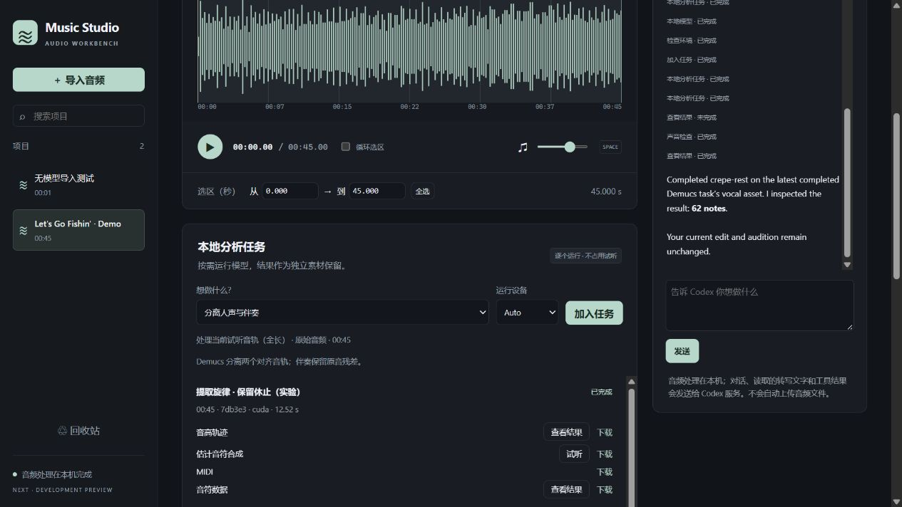

# Music Studio Next 开发预览

[English](next-preview.en.md) · [开发计划](workbench-plan.md) · [旋律对比](melody-next.md)

这是 `codex/audio-workbench-next` 分支中的 **0.2.0.dev1**，尚未替换稳定发布版。
原仓库的 `main`、`v0.1.2` 和原有歌曲工作区独立保留。

## 当前可以做什么

- 导入音频即可使用，无需先分离、转写或安装神经模型。
- 拖选、输入起止秒数、缩放波形、循环试听。
- 裁剪、增益、淡入淡出、左右平衡、峰值归一化、倒放。
- 对已有、时间一致的人声与伴奏轨道混音。
- 生成独立预览；采用后可撤销、重做，重启仍保留。
- 以 16 / 24-bit PCM 或 32-bit float WAV 导出正在试听的版本。
- 删除项目到回收站、恢复项目、重命名、搜索、中英切换。
- MCP 与内嵌 Codex 操作同一份项目、选区、预览和操作记录。
- 按需运行本地分轨、Whisper / Qwen 转写、两种旋律解码、节拍与电平检查。
- 在统一队列查看状态、取消任务；结果成为有来源的素材，支持试听与下载。
- 转写逐行改字、另存版本，下载 TXT / LRC / SRT。见[模型与任务说明](next-models.md)。

经典分析页面和内置的 45 秒授权示例仍然可用。示例包含预计算分轨；
上传自己的音频不会自动运行整套分析。

## 启动

Windows 安装 Python 3.11 / 3.12 后，双击 `Start-Music-Studio-Next.cmd`。
没有 Next 环境时会首次安装，稳定版的 `.venv` 不会被修改。也可以手动安装后启动：

```powershell
.\scripts\setup-next.ps1
.\Start-Music-Studio-Next.cmd
```

首次安装会从包仓库下载 UI、音频解码和 MCP 依赖，不下载神经模型。
Next 使用 `.venv-next`、`outputs/next` 和从 8900 开始的独立端口。
开发工作区已有隔离运行环境时，启动器也可使用 `.artifacts/workbench-env`。
无需停止原来的稳定版。

Linux / macOS 或手动安装：

```bash
python3 -m venv .venv-next
source .venv-next/bin/activate
python -m pip install -e '.[ui,audio,agent]'
python -m music_studio ui --interface next --workspace outputs/next --port 8900 --open
```

不支持 PowerShell 的环境请使用上面的 Python 命令。Windows 可在安装时用
`setup-next.ps1 -Python <Python解释器路径>` 指定解释器。

## Codex 与 MCP

打开右侧 **Codex 助手**，点击 **连接本机 Codex**。需要已安装的 Codex CLI 和已有登录。
不会读取或复制登录文件，也不修改用户的全局 Codex 配置。

例如：“把当前音频降低 3 dB，先做试听预览，不要采用。”
实际工具调用完成后，候选卡会注明 `CODEX`。可以在界面试听、采用或继续手动编辑。
默认先生成预览；原音始终保留。界面与 Agent 使用相同的版本冲突检查。

音频运算在本机；Codex 推理需要其服务，对话、它读取的转写文字及工具结果会发送给该服务。
不自动上传或附加音频。测量数值不能替代实际听音，助手也不应声称已经听过。
内嵌连接关闭了此进程中的 shell、外部 MCP、连接器和子 Agent；不改变全局设置。
当前实测 CLI 为 `0.162.0-alpha.17.2`。官方 app-server 的动态工具接口仍为实验接口，
不同 CLI 版本可能需要适配。

若希望在现有 Codex 中使用，MCP 启动命令是：

```text
<Next环境中的python> -m music_studio.studio.mcp --workspace <Next工作区绝对路径>
```

可复制的配置示例（把路径换成自己的；此项目不会自动写入它）：

```toml
[mcp_servers.music_studio]
command = "/absolute/path/to/.venv-next/bin/python"
args = ["-m", "music_studio.studio.mcp", "--workspace", "/absolute/path/to/outputs/next"]
tool_timeout_sec = 180
```

Windows 的 `command` 使用 `.venv-next/Scripts/python.exe`，TOML 可用正斜杠路径。
15 个共享工具覆盖编辑、模型检查、按需分析、队列、结果读取和转写改字。
协议依据 [官方 MCP 文档](https://learn.chatgpt.com/docs/extend/mcp?surface=cli)
与 [官方 app-server 文档](https://learn.chatgpt.com/docs/app-server)。

## 本阶段的边界

模型登记、隔离检查与按需队列已接入；模型安装独立于基础编辑环境。
语音增强、语义分离、长录音流式处理与自动模型选择仍待开发。
经典版的完整歌曲分析继续保留，需要另外安装推理依赖和模型。
编辑版本与经典分析版本是两种独立记录，不会自动把裁剪后的音频覆盖成旧歌曲的原音。

当前电平检查是样本峰值和整段 RMS，不是 LUFS / 真峰值；不承诺广播响度合规。
整数导出会拒绝超过满幅的音频，不会悄悄削波。
ROSVOT 与 Basic Pitch 目前只在独立实验中评测，没有替换默认旋律模型。
对话会话目前在本次服务运行中保留；重启后重新连接。音频编辑状态和预览保存在工作区。

## 验证记录

本机已通过 84 项 Python 与 19 项 Node 检查，覆盖核心编辑、队列、进程树取消、崩溃恢复、改字版本和冻结基准。
真实 MCP 子进程和 SDK 客户端已验证，
本机 Codex 也实际调用工具生成了六秒、降低 3 dB 的预览，且未替换当前版本。
浏览器已验证中文路径文件导入、删除/恢复、采用/撤销/重做、实际 WAV 下载、选区循环。
播放中通过真实 MCP 新增预览并切换语言，原音连续播放到 32 秒，没有重置。
另在完全没有 Torch / Whisper 的干净环境安装 wheel，通过导入、编辑、历史和导出流程。
测试不会联网调用模型；真实模型/Agent 实测单独记录。

新增[真实任务记录](../benchmarks/results/next-capabilities-2026-10-16.json)：
7 个入口在 15 秒授权示例片段上均完成，分轨重构误差为 0，两个 MIDI 往返误差均约 0.21 ms。
这只是功能验证，不是识别准确率或长歌曲性能承诺。另在浏览器完成 45 秒真实分轨与 Whisper 转写，
播放从 7.7 秒前进到 31.4 秒，任务完成和切换语言均没有重载该音轨；逐行改字生成了新版本。
真实 Codex 还调用了模型检查、排队、查询与结果读取，完成 45 秒新分轨的旋律任务并读出 62 个音符；
后端核验当前编辑仍为原来的 v4，没有自动采用或切换试听。一次不适合读取的结果请求被拒绝后，
助手选择了正确的音符 JSON 完成查询；界面会明确显示该工具调用未完成，不会永远显示“运行中”。



[完整编辑工作台截图](images/next-workbench-en.jpg) · [中文剪辑预览](images/next-workbench-zh.jpg)

示例为 Karissa Hobbs 的 *Let's Go Fishin'*，CC BY 3.0。
图中包含截取、倒放、调整增益后的独立预览；艺术家未为本项目背书。
[来源与修改说明](../src/music_studio/ui/demo/ATTRIBUTION.md) · [英文完整截图](images/next-workbench-en.jpg)

测试命令：

```bash
python -m pip install -e '.[ui,audio,agent,benchmark,dev]'
python -m ruff check .
python -m pytest -q
node --test tests/ui_playback.test.cjs tests/ui_i18n.test.cjs tests/ui_transport.test.cjs
```
